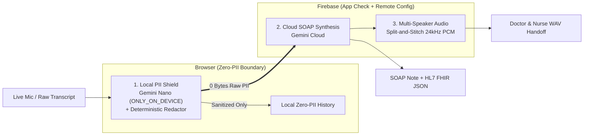

# EchoGuard

Cloud AI can turn a messy telehealth transcript into a clean SOAP note in 5 seconds.

So why aren't doctors just pasting patient notes into a cloud LLM?

Because a real transcript has the patient's name, date of birth, MRN, phone number, and even their mother's name. Send that straight to the cloud and you have a privacy breach.

EchoGuard stops that before anything leaves the browser.

On-device **Gemini Nano** (via Firebase AI Logic) and a local deterministic redactor strip all PII first. Only the scrubbed text—**0 bytes of raw PII**—goes to Cloud Gemini for the SOAP note, HL7 FHIR JSON export, and a 2-speaker Doctor–Nurse audio handoff.

To be fair, EchoGuard is not a full EHR system, and on-device Gemini Nano only runs in Desktop Chrome right now. On other browsers, it falls back to our local deterministic redactor so raw PII still stays on your machine.

> 🔗 **Live Demo:** `https://echoguard-nine.vercel.app`  
> 🎥 **3-Minute Demo Video:** `https://youtu.be/k6pcg5y2g9o`

---

## How It Works

EchoGuard has no patient database. Everything runs through a 3-stage hybrid pipeline:

1. **Local PII Shield (On-Device)**  
   Dictate via Live Mic or paste a clinical transcript. Gemini Nano (`InferenceMode.ONLY_ON_DEVICE`) and our fail-closed regex redactor strip patient names, caregiver names (`mother`, `father`, `guardian`), spoken and numeric DOBs, MRNs, insurance IDs, and phone numbers inside the browser.
2. **Cloud SOAP Note & HL7 FHIR Export**  
   Only the sanitized payload crosses into Cloud Gemini. You get a structured SOAP note (_Subjective, Objective, Assessment, Plan_) and a one-click **HL7 FHIR JSON** export.
3. **Multi-Speaker Clinical Handoff (Doctor & Nurse)**  
   Busy wards run on spoken handoffs, not walls of text. EchoGuard turns the plan into a 2-speaker Doctor and Nurse audio briefing using `gemini-2.5-flash-preview-tts`, with instant `.wav` download.



---

## 4 Real Problems We Hit (and How We Fixed Them)

**Single-request multi-speaker TTS mixed up the voices.**  
When we asked TTS to voice both Doctor and Nurse in one request, the voices drifted away from the profiles picked in Settings. So we split the script into a strict 2-turn hard cap, run each speaker in parallel with their exact voice profile, and stitch the raw 24 kHz 16-bit mono PCM buffers with a 350 ms pause.

**TTS daily quotas ran out fast during testing.**  
Replaying a handoff or testing voice previews in Settings burned quota every click. Now we cache raw `Uint8Array` PCM bytes in a bounded FIFO `Map` (never Blob URLs, so React cleanup never breaks cached audio). Replaying a cached voice or handoff costs 0 API calls.

**One stray click could mix two patients together.**  
If a clinician clicked Live Mic or a sample button while an old encounter was still on screen, new speech would append to the old chart. Now the entire input card locks down the moment an encounter finishes. You have to click **+ New Encounter** to start a new patient.

**Spoken dictation broke simple PII regexes.**  
During live mic tests, phrases like `"brought in by mother Sarah Lynn, born September 18th 2020"` slipped past basic patterns. We hardened the local redactor with case-sensitive caregiver/family name matching and spoken date-of-birth patterns—without redacting clinical prose like `"Mother reports fever"` or `"born at 38 weeks"`.

---

## Firebase Stack

| Firebase Product           | What It Does in EchoGuard                                                                                                                        |
| :------------------------- | :----------------------------------------------------------------------------------------------------------------------------------------------- |
| **Firebase AI Logic**      | Runs the hybrid pipeline: on-device Gemini Nano (`ONLY_ON_DEVICE`), Cloud Gemini SOAP synthesis, and Gemini Flash TTS.                           |
| **Firebase App Check**     | Protects AI Logic and Remote Config endpoints with reCAPTCHA Enterprise (and debug tokens for local dev).                                        |
| **Firebase Remote Config** | Dynamically serves `default_cloud_model`, `tts_model`, and `soap_system_prompt` so we can update models or clinical prompts without redeploying. |

---

## Tech Stack

- **Frontend:** React 19, TypeScript, Vite 8, Tailwind CSS v4
- **AI & Platform:** Firebase SDK (`firebase/ai`, `firebase/app-check`, `firebase/remote-config`), Web Speech API
- **Audio:** Custom 24 kHz 16-bit mono PCM stitcher + WAV encoder + FIFO `Uint8Array` cache
- **Dev & Build:** Docker / Docker Compose, `oxlint`, `tsc`

---

## Run It Locally

### Prerequisites

- Docker & Docker Compose (or Node.js 20+)
- A Firebase Project with **AI Logic**, **App Check**, and **Remote Config** enabled
- Desktop Chrome with Built-in AI (Gemini Nano) enabled (other browsers fall back safely to deterministic local redaction)

### 1. Clone & Configure `.env.local`

```bash
git clone https://github.com/afiqxeon/echoguard
cd echoguard
cp .env.example .env.local
```

Fill in `.env.local` with your Firebase Web App credentials:

```env
VITE_FIREBASE_API_KEY=your_api_key
VITE_FIREBASE_AUTH_DOMAIN=your_project.firebaseapp.com
VITE_FIREBASE_PROJECT_ID=your_project_id
VITE_FIREBASE_STORAGE_BUCKET=your_project.firebasestorage.app
VITE_FIREBASE_MESSAGING_SENDER_ID=your_sender_id
VITE_FIREBASE_APP_ID=your_web_app_id

# Firebase App Check
VITE_RECAPTCHA_ENTERPRISE_SITE_KEY=your_recaptcha_site_key
VITE_APPCHECK_DEBUG_TOKEN=your_local_debug_token

# Optional: test UI offline with 0 API usage
VITE_ENABLE_MOCK_MODE=false
```

### 2. Configure Firebase Services

In **Firebase Console**, enable and configure the following for your Web App:

1. **Firebase AI Logic**: Enable **Gemini Developer API** as the AI backend provider.
2. **Firebase App Check**: Register your Web App with **reCAPTCHA Enterprise** (and optionally add a local debug token under **Manage debug tokens** for localhost).
3. **Firebase Remote Config**: Add and publish these 3 String parameters:
   - `default_cloud_model`: `gemini-3.8-flash`
   - `tts_model`: `gemini-2.5-flash-preview-tts`
   - `soap_system_prompt`: `You are a strict clinical documentation assistant. Convert the following PII-redacted transcript into a highly structured medical SOAP note (Subjective, Objective, Assessment, Plan). Do not invent any patient identifiers.`

### 3. Start the App

With Docker Compose:

```bash
docker compose up --build
```

Or with Node.js:

```bash
npm install
npm run dev
```

Open `http://localhost:5173`.

### 4. Lint & Build

```bash
# Docker
docker compose exec web sh -c "npm run lint && npm run build"

# Local Node
npm run lint && npm run build
```

---

## Deploy to Vercel

1. Import this repository into **Vercel** (Framework Preset: **Vite**, Build Command: `npm run build`, Output Directory: `dist`).
2. Add the same `VITE_FIREBASE_*` and `VITE_RECAPTCHA_ENTERPRISE_SITE_KEY` environment variables from `.env.local` into **Vercel → Project Settings → Environment Variables** (omit `VITE_APPCHECK_DEBUG_TOKEN` in production).
3. Add your production `*.vercel.app` domain to:
   - **Firebase Console → Authentication → Settings → Authorized domains**
   - **Google Cloud Console → reCAPTCHA Enterprise → Allowed domains**

---

## Project Structure

```text
src/
├── components/
│   ├── common/
│   │   └── SpinnerIcon.tsx            # Reusable loading indicator
│   ├── layout/
│   │   ├── EncounterSidebar.tsx       # Zero-PII local encounter history sidebar
│   │   └── Navbar.tsx                 # Hybrid status badge, + New Encounter & Settings controls
│   ├── workspace/
│   │   ├── AudioHandoffCard.tsx       # Card 3: Multi-speaker Doctor & Nurse TTS + WAV download
│   │   ├── LocalPayloadCard.tsx       # Card 1: Sanitized transcript & Zero-PII audit receipt
│   │   ├── SoapNoteCard.tsx           # Card 2: Structured SOAP note, copy & HL7 FHIR JSON export
│   │   └── TranscriptInputCard.tsx    # Transcript input, encounter lock-down, mic & 3-step tracker
│   ├── HowItWorksModal.tsx            # Zero-trust hybrid architecture walkthrough modal
│   └── SettingsModal.tsx              # Cloud model & Doctor/Nurse voice profile controls
├── constants/
│   ├── models.ts                      # Supported Cloud Gemini model options
│   └── sampleNotes.ts                 # Built-in clinical sample transcripts
├── hooks/
│   └── useClinicalDictation.ts        # Web Speech API live microphone dictation hook
├── services/
│   └── firebaseHybrid.ts              # AI Logic (Nano + Cloud + TTS), App Check, Remote Config & PCM cache
├── types/
│   ├── clinical.ts                    # Pipeline stage, engine mode, audit receipt & session types
│   └── settings.ts                    # Voice profile & application settings types
├── utils/
│   ├── clinicalExport.ts              # HL7 FHIR JSON & WAV export helpers
│   ├── deterministicRedactor.ts       # Fail-closed local PII redactor (names, caregivers, DOB, MRN, phone)
│   ├── sessionStorage.ts              # Zero-PII localStorage encounter history
│   └── settingsStorage.ts             # Persistent user preferences & voice options
└── PIIRedactor.tsx                    # Main hybrid pipeline orchestrator
```

---

## Disclaimer

EchoGuard is a technical prototype demonstrating zero-trust hybrid AI for telehealth workflows. It is not a certified medical device and should not be used for real patient diagnosis or treatment without qualified clinical review.

Built by **Taufiqurrohman** ([@afiqxeon](https://github.com/afiqxeon)) — powered by Firebase AI Logic, Gemini Nano, and Gemini Cloud.

## License

MIT
